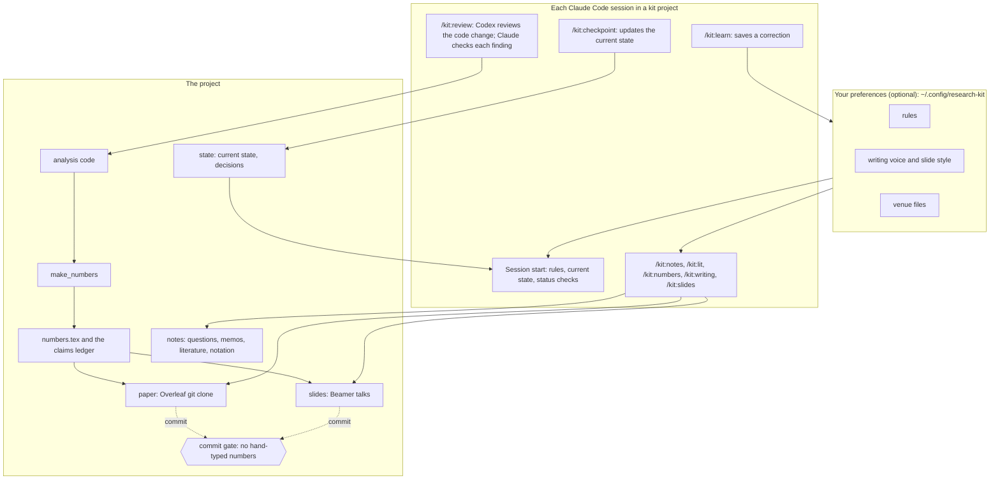

# research-kit

A Claude Code plugin for empirical research papers. It carries a project's state from one session to the next, keeps every number in the paper and the talks generated from code, and gives Claude written procedures for notes, literature, prose, slides and code review.

The rules and the writing voice it ships are defaults. You can replace any of them with your own; see [Changing the defaults](#changing-the-defaults).

## What it does



- **Session start.** Every session in a kit project begins with the rules, the project's current state (`state/CURRENT_STATE.md`) and a status block: uncommitted changes, new commits on Overleaf, hand-typed numbers in the paper and the slides, and the code review status. Outside kit projects the kit does nothing.
- **Generated numbers.** Each language's `make_numbers` script writes `numbers.tex`, one LaTeX macro per result, and the claims ledger records which script produced each one. The paper and the talks use the macros. A git hook blocks a commit that adds a hand-typed number to the paper or the slides.
- **Checkpoints.** `/kit:checkpoint` updates `CURRENT_STATE.md` before a session ends, so the next session starts where this one stopped.
- **Code review.** With the Codex CLI installed, `/kit:review` has Codex review a code change. Claude then checks each finding against the code and proposes fixes for your approval.
- **Lessons.** When you correct Claude and want the correction kept, `/kit:learn` saves it in one place: your rules, your voice, a venue file or the project's `CLAUDE.md`.

## Prerequisites

- Claude Code, git and [uv](https://docs.astral.sh/uv/).
- For R projects: R, with renv in your user library (`install.packages("renv")`).
- TeX with `latexmk`, to build the paper and the talks.
- An Overleaf project with Git access (Overleaf menu, Git), for the paper.
- Optional: the [Codex CLI](https://github.com/openai/codex), signed in, for `/kit:review`.

Tested on Linux. Windows is not supported.

## Install

```
claude plugin marketplace add zjelveh/research-kit
claude plugin install kit@research-kit
```

The `/kit:` skills are available in every project. The session-start hook runs only in kit projects (folders with `.claude/research.yml`) and is silent everywhere else.

To update: `claude plugin marketplace update research-kit`, then `claude plugin update kit@research-kit`.

## Quick start

In Claude Code, run `/kit:new-project <name>`. The first time, it runs `kit setup`, which creates a small Python environment in `~/.local/share/research-kit` (this needs uv). It then asks which languages the paper uses and which folder the project goes in, creates the project and walks you through attaching the Overleaf clone.

## A kit project

```
my-paper/
├── .claude/research.yml   languages, paper folder, venue
├── CLAUDE.md              rules for this project only
├── analysis/              code; analysis/numbers/make_numbers.R or .py writes the numbers
├── paper/                 git clone of the Overleaf project
│   └── generated/         numbers.tex and notation.tex, written by the kit
├── slides/                Beamer talks
├── notes/                 research questions, memos, notation, literature map and searches
└── state/                 CURRENT_STATE.md, DECISIONS.md, CLAIMS_LEDGER.md
```

## Skills

| Skill | What it does | When to use |
|---|---|---|
| `/kit:new-project` | Sets up the kit, scaffolds a project, attaches the Overleaf clone and checks the setup | Starting a new paper |
| `/kit:checkpoint [quick\|full]` | Updates `CURRENT_STATE.md` and commits the files it changed; full mode adds decisions, pointers, the ledger check and repo status | Ending a session, or before a compaction |
| `/kit:learn` | Saves a lesson to your rules, voice, slide style or a venue file, or to the project's `CLAUDE.md` | A correction that should hold from now on |
| `/kit:notes` | Research questions, dated memos and notation | Recording an idea, conjecture, memo or symbol |
| `/kit:lit` | Literature map, verified `.bib` entries and saved searches | Searching, adding or citing literature |
| `/kit:numbers` | Generated number macros and the numbers check | Adding a number, table or figure, or a blocked commit |
| `/kit:writing` | Base voice, methods-paper rules, venue rules and the editing process | Drafting or editing manuscript prose |
| `/kit:slides` | Beamer talks from the kit's template, slide by slide | Creating or revising a talk |
| `/kit:review` | Codex reviews the change; Claude checks every finding and proposes fixes for approval | Before reporting a change to 2+ code files as done |

## Changing the defaults

Each default below is a file in the kit's `plugins/kit/defaults/` folder. `kit customize <item>` copies it into your personal folder, `~/.config/research-kit/`; edit the copy there. Your copy then replaces the default; the two are not merged. `kit which <item>` prints the file in effect, and `kit where` prints the personal folder.

| Item | What it sets | Command |
|---|---|---|
| `rules` | The rules loaded at every session start (at most 1,536 bytes) | `kit customize rules` |
| `writing-voice` | The base voice for prose and slide text, with its pre-send checks | `kit customize writing-voice` |
| `slides-style` | The slide conventions on top of the kit's fixed slide rules | `kit customize slides-style` |
| `venue <name>` | Rules for a target journal. The kit ships `undecided`; set a project's venue in its `.claude/research.yml` | `kit customize venue <name>` |

Where new projects go is a setting: put `projects_root: /path/to/projects` in `~/.config/research-kit/config.yml`. Without it, `/kit:new-project` asks.

Inside Claude Code, ask Claude to run these commands. In a terminal, after `kit setup`, the launcher is `~/.local/share/research-kit/plugin/bin/kit`. `XDG_CONFIG_HOME` and `XDG_DATA_HOME` move both folders, and `KIT_PERSONAL_DIR` sets the personal folder directly.

`/kit:learn` edits these personal files for you. If the personal folder is a git repository, it commits each change.

## Uninstall

```
claude plugin uninstall kit@research-kit
claude plugin marketplace remove research-kit
rm -rf ~/.local/share/research-kit
```

Your personal folder, `~/.config/research-kit`, is left alone. Kit projects keep working as plain git repositories, except their commit hooks: remove `.git/hooks/pre-commit` in the project and in its `paper/` clone.

## Known issues

See [plugins/kit/KNOWN-ISSUES.md](plugins/kit/KNOWN-ISSUES.md).

## Development

`bin/setup.sh` creates `.venv` with the test dependencies (`KIT_PYTHON` picks the Python, 3.12 or later). Run the tests with `.venv/bin/python -m pytest` and `Rscript -e 'testthat::test_dir("tests/r")'`.

## License

MIT; see [LICENSE](LICENSE).
