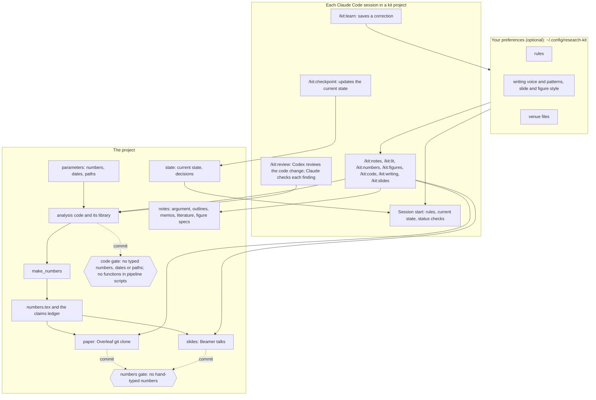

# research-kit

A Claude Code plugin for empirical research papers. It carries a project's state from one session to the next, keeps every number in the paper and the talks generated from code, keeps the numbers, dates and paths that the analysis code uses in parameter files, and gives Claude written procedures for notes, literature, analysis code, figures, prose, slides and code review.

The rules and the writing voice it ships are defaults. The writing voice is an example of what a voice file holds, meant to be replaced with your own. You can replace any default; see [Changing the defaults](#changing-the-defaults).

## What it does



- **Session start.** Every session in a kit project begins with the rules, the project's current state (`state/CURRENT_STATE.md`) and a status block: uncommitted changes, new commits on Overleaf, hand-typed numbers in the paper and the slides, and the code review status. Outside kit projects the kit does nothing.
- **Analysis code.** The project's library is the paper's code as it will be released: every step that produces a result in the paper is a function there, and pipeline scripts are thin drivers that call it. Before writing code, `/kit:code` has Claude read a map of the library's functions and the parameters. A quick question gets a short, dated script in `analysis/explore/` that calls the library, instead of a fresh copy of the loading and sample logic. A git hook blocks a commit that adds a function to a pipeline script.
- **Parameters.** Every number, date and path the code uses lives in `analysis/params.yml`, with a comment saying what it is and why, and code reads it with `param("name")`. A git hook blocks a commit that types such a value on a new or edited line.
- **Generated numbers.** Each language's `make_numbers` script writes `numbers.tex`, one LaTeX macro per result, and the claims ledger records which script produced each one. The paper and the talks use the macros. A git hook blocks a commit that adds a hand-typed number to the paper or the slides.
- **Figures.** `/kit:figures` records each figure's data, the reader's task and the chosen idiom in a short spec, checks the design against a catalogue of 52 visualization idioms, and only then writes the plotting code.
- **Prose.** `/kit:writing` works from the paper's argument down: a short argument file, a section outline you approve, the whole section drafted and read in context, and line edits last.
- **Checkpoints.** `/kit:checkpoint` updates `CURRENT_STATE.md` before a session ends, so the next session starts where this one stopped.
- **Code review.** With the Codex CLI installed, `/kit:review` has Codex review a code change. Claude then checks each finding against the code and proposes fixes for your approval.
- **Lessons.** When you correct Claude and want the correction kept, `/kit:learn` saves it in one place: your rules, your voice or writing patterns, your slide or figure style, a venue file or the project's `CLAUDE.md`.

## Prerequisites

- Claude Code, git and [uv](https://docs.astral.sh/uv/).
- For R projects: R, with renv in your user library (`install.packages("renv")`).
- TeX with `latexmk`, to build the paper and the talks.
- An Overleaf project with Git access (Overleaf menu, Git), for the paper.
- Optional: the [Codex CLI](https://github.com/openai/codex), signed in, for `/kit:review`.

Tested on Linux. Windows is not supported.

## Install

```
claude plugin marketplace add zjelveh/research-kit
claude plugin install kit@research-kit
```

The `/kit:` skills are available in every project. The session-start hook runs only in kit projects (folders with `.claude/research.yml`) and is silent everywhere else.

To update: `claude plugin marketplace update research-kit`, then `claude plugin update kit@research-kit`. A project made with an earlier version gets the parameter files and the code gate with `kit scaffold.py add-params`, and running it again after an update refreshes the kit's readers; see [Analysis code and parameters](#analysis-code-and-parameters).

## Quick start

In Claude Code, run `/kit:new-project <name>`. The first time, it runs `kit setup`, which creates a small Python environment in `~/.local/share/research-kit` (this needs uv). It then asks which languages the paper uses and which folder the project goes in, creates the project and walks you through attaching the Overleaf clone.

## A kit project

```
my-paper/
├── .claude/research.yml      languages, paper folder, venue, and optionally the library
├── CLAUDE.md                 rules for this project only
├── analysis/                 code
│   ├── params.yml            every number, date and path the code uses
│   ├── params.R, params.py   the readers that give code param("name"), one per language
│   ├── explore/              dated scripts for quick questions, with their own params.yml
│   ├── numbers/              make_numbers.R or .py, which write the paper's numbers
│   └── run_all.R or .py      runs the pipeline's driver scripts in order, once the project has some
├── pkg/                      the project's own R or Python package, if it has one
├── paper/                    git clone of the Overleaf project
│   └── generated/            numbers.tex and notation.tex, written by the kit
├── slides/                   Beamer talks
├── notes/                    argument, outlines, research questions, memos, notation, literature, figure specs
└── state/                    CURRENT_STATE.md, DECISIONS.md, CLAIMS_LEDGER.md
```

## Skills

| Skill | What it does | When to use |
|---|---|---|
| `/kit:new-project` | Sets up the kit, scaffolds a project, attaches the Overleaf clone and checks the setup | Starting a new paper |
| `/kit:checkpoint [quick\|full]` | Updates `CURRENT_STATE.md` and commits the files it changed; full mode adds decisions, pointers, the ledger check, repo status and the code map | Ending a session, or before a compaction |
| `/kit:learn` | Saves a lesson to your rules, voice, writing patterns, slide or figure style, or a venue file, or to the project's `CLAUDE.md` | A correction that should hold from now on |
| `/kit:notes` | Research questions, dated memos and notation | Recording an idea, conjecture, memo or symbol |
| `/kit:lit` | Literature map, verified `.bib` entries and saved searches | Searching, adding or citing literature |
| `/kit:numbers` | Generated number macros and the numbers check | Adding a number, table or figure, or a commit blocked by the numbers check |
| `/kit:figures` | Designs a figure from its data and the reader's task with Munzner's idioms, or critiques an existing one | Making or reviewing a figure |
| `/kit:code` | Reads the project's code map first, keeps definitions in the project's library and every number, date and path in its parameter files, and answers quick questions with dated explore scripts; a pre-commit check blocks typed values and functions in pipeline scripts | Writing or changing analysis code, or a commit blocked by the code gate |
| `/kit:writing` | Works from the paper's argument to a section outline, a whole-section draft and line edits, with the voice, writing patterns and venue rules | Drafting or editing manuscript prose |
| `/kit:slides` | Beamer talks from the kit's template, slide by slide | Creating or revising a talk |
| `/kit:review` | Codex reviews the change; Claude checks every finding and proposes fixes for approval | Before reporting a change to 2+ code files as done |

`/kit:figures` builds on Tamara Munzner's framework in *Visualization Analysis & Design* (2014) and her lecture decks: each idiom file cites the deck pages it rests on, and idioms marked `origin: kit` are the kit's own, built in her terms. Idioms you add are marked `origin: own`.

## Analysis code and parameters

**The library.** The library is the paper's code as it will be released: every step that produces a result in the paper (data preparation, samples, estimation, the computations behind each number, the tables and the figures) is a function there. It is the project's package under `pkg/`, or the folders and files named in `library:` in `.claude/research.yml`, such as `library: [analysis/R]`. Pipeline scripts are thin drivers that read parameters, call the library in order and write outputs, and a run-all script runs them, so a replicator runs one command. The `make_numbers` scripts are drivers too: they read values from committed results, and anything they compute comes from a library function. A request calls the library; a library function that nearly fits is extended; a genuine one-off goes in an explore script that calls the library. `kit code_map.py --project .` prints the library's functions, with how many files call each one, and the parameters, with the scripts that use them. `--files <files>` checks changed files for typed values, repeated code, near copies of functions, paper outputs with several writers and data read around the library; `--all` lists everything, for a clean-up.

**The parameter files.** `analysis/params.yml` holds what the pipeline uses, and a change to one of its values needs your approval. `analysis/explore/params.yml` holds the one-off values of quick questions. The format is a small subset of YAML that R and Python read without packages:

```yaml
# Smallest group the tables report; smaller groups are suppressed.
min_group_size: 20
# First and last year of the analysis panel.
panel_years: [1990, 2019]
# The cleaned analysis dataset, relative to the project root.
analysis_data: 'data/analysis.parquet'
```

Each entry has a comment line above it. Values are numbers, single-quoted strings (dates and paths always quoted), `true` or `false`, or a one-line list. Scripts read values with `param("min_group_size")`, after `source("analysis/params.R")` in R or, in Python, putting `analysis/` on `sys.path` and `from params import param, param_path`. `param_path("analysis_data")` gives a path parameter joined to the project root. The readers find the parameter files from their own place, so scripts may run from any folder in the project. An unknown name, or a missing `analysis/params.yml`, is an error. A package can't read the parameter files, since it has to work outside the paper; its functions take values as arguments, and the calling script passes `param(...)`.

**The code gate.** The code repo's pre-commit hook flags, on the lines a commit adds or changes:
- numbers other than 0, 1, 2 and 100, dates, and paths or file names. A line that has to keep a value ends with `# literal: <reason>`, which `/kit:review` sees;
- a new function or class defined in a pipeline script (a driver's `main` or `parse_args` aside). Functions belong in the library. The library, packages, explore scripts and the run-all script may define them, and a function a script already had may still be edited;
- a new library function that nearly copies another library function once local names and values are set aside, such as a pool loader with a cutoff of 30 beside the same loader with 20. One function with an argument does for both; a real difference ends the definition line with `# distinct: <reason>`.

Tests, archived code (`archive/`, `legacy/`), `renv/` and hidden folders are exempt from these checks. `kit lint_code.py --project . --all` counts a project's existing findings by file.

**Projects made before these files.** Run `kit scaffold.py add-params` in the project. It adds the parameter files and readers the project lacks, ignores `analysis/explore/out/`, commits those files, and turns the code gate on. It refuses, and changes nothing, if the project has its own file of the same name. Existing code keeps committing: only new and edited lines are checked, and a function a script already had may still be edited.

## Changing the defaults

Each default below is a file in the kit's `plugins/kit/defaults/` folder. `kit customize <item>` copies it into your personal folder, `~/.config/research-kit/`; edit the copy there. Your copy then replaces the default; the two are not merged. `kit which <item>` prints the file in effect, and `kit where` prints the personal folder.

| Item | What it sets | Command |
|---|---|---|
| `rules` | The rules loaded at every session start (at most 1,536 bytes) | `kit customize rules` |
| `writing-voice` | An example voice for prose and slide text, with its pre-send checks, to replace with your own | `kit customize writing-voice` |
| `writing-patterns` | How paragraphs and sections are built: results in words against the baseline, a synthesis after a series, the usual section sequence | `kit customize writing-patterns` |
| `slides-style` | The slide conventions on top of the kit's fixed slide rules | `kit customize slides-style` |
| `figure-style` | The colour, label and size conventions for figures | `kit customize figure-style` |
| `idiom <id>` | One idiom in the figures catalogue; a new id adds an idiom of your own | `kit customize idiom <id>` |
| `venue <name>` | Rules for a target journal. The kit ships `undecided`; set a project's venue in its `.claude/research.yml` | `kit customize venue <name>` |

Where new projects go is a setting: put `projects_root: /path/to/projects` in `~/.config/research-kit/config.yml`. Without it, `/kit:new-project` asks.

Inside Claude Code, ask Claude to run the `kit` commands in this README. In a terminal, after `kit setup`, the launcher is `~/.local/share/research-kit/plugin/bin/kit`. `XDG_CONFIG_HOME` and `XDG_DATA_HOME` move both folders, and `KIT_PERSONAL_DIR` sets the personal folder directly.

`/kit:learn` edits these personal files for you. If the personal folder is a git repository, it commits each change.

## Uninstall

```
claude plugin uninstall kit@research-kit
claude plugin marketplace remove research-kit
rm -rf ~/.local/share/research-kit
```

Your personal folder, `~/.config/research-kit`, is left alone. Kit projects keep working as plain git repositories, except their commit hooks: remove `.git/hooks/pre-commit` in the project and in its `paper/` clone. The parameter files and their readers are ordinary project files and keep working.

## Known issues

See [plugins/kit/KNOWN-ISSUES.md](plugins/kit/KNOWN-ISSUES.md).

## Development

`bin/setup.sh` creates `.venv` with the test dependencies (`KIT_PYTHON` picks the Python, 3.12 or later). Run the tests with `.venv/bin/python -m pytest` and `Rscript -e 'testthat::test_dir("tests/r")'`.

## License

MIT; see [LICENSE](LICENSE).
